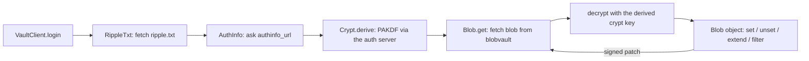

<p align="center"></p>

<p align="center">
  
  
  
  
</p>

> [!NOTE]
> **Historical project (spring 2014).** Written for Node 0.10 and the browser, and not maintained. The Ripple Vault service it talks to (the blob vault behind ripple.com logins) has since gone away, so the login calls fail today. `ripple-lib`, which it depends on, is deprecated. Kept for the record. See [docs/STATUS.md](docs/STATUS.md) for what was actually run.

# ripple-vault-client

## What it is

A JavaScript / HTTP client to interact with Ripple Vault servers. It lets an application in any JavaScript environment (Node, or the browser through a Webpack build) log in with the Ripple vault and read the decrypted data stored using credentials originally obtained at ripple.com: the wallet "blob" and the secret inside it.

## Features

- Log in with a username and password and get back the decrypted blob, its crypt key and its id.
- Log in again later with only the id and crypt key, no password.
- Unlock the wallet secret with the encryption secret, username and password.
- Check whether a name exists, register a new blob, verify an email token.
- Look up a Ripple name from an address.
- Edit the blob with small operations (`set`, `unset`, `extend`, `unshift`, `filter`) that are signed and sent to the vault.
- Discovers the vault through the domain's `ripple.txt` (tries `ripple.`, `www.` and bare domain, https first, then http).

## Install

```sh
npm install ripple-vault-client
```

It is on npm (versions 0.4.8 to 1.1.0, checked 2026-11-20), published from this repository's `package.json` (entry point `src`). To get a browser bundle, run `grunt` (Webpack writes `build/ripple-vault-client.js`, exported as `RippleVaultClient`).

## Usage

```js
var VaultClient = require('ripple-vault-client');

var vaultClient = new VaultClient(domain);   // defaults to ripple.com

vaultClient.login(username, password, callback);
vaultClient.relogin(url, id, cryptKey, callback);   // url of the blob vault (the original README left it out)
vaultClient.unlock(username, password, encryptSecret, callback);
vaultClient.loginAndUnlock(username, password, callback);
vaultClient.exists(username, callback);
vaultClient.register(options, callback);
```

### Blob client methods

```js
blobClient.get(url, id, crypt, callback);
blobClient.create(options, callback);
blobClient.verify(url, username, token, callback);
```

### Blob methods

```js
blob.encrypt();
blob.decrypt(encryptedBlob);
blob.encryptSecret(encryptionKey);
blob.decryptSecret(encryptionKey, secret);

blob.set(pointer, value, callback);
blob.unset(pointer, callback);
blob.extend(pointer, value, callback);
blob.unshift(pointer, value, callback);
blob.filter(pointer, field, value, subcommands, callback);
```

Pointers are JSON-pointer style paths into the blob.

## How it works



By design the password is not sent to the vault. The client derives login keys with a remote key derivation (PAKDF) step, uses one key as the blob id and one to decrypt it, and sends edits as signed patches.

## Spec tests

`npm test` runs `mocha -R spec spec/`. The specs were written against the live vault, so they describe the intended behaviour:

- **Vault client:** initialization with a domain, default to ripple.com, login, relogin, unlock, loginAndUnlock.
- **Blob:** set, extend, unset, unshift, filter, consolidate.

Today only the two initialization specs can pass, because the rest need a live vault. See [docs/STATUS.md](docs/STATUS.md).

## Project layout

```
src/index.js      VaultClient: login, relogin, unlock, exists, register
src/authinfo.js   fetches the auth info for a user
src/rippletxt.js  finds and parses a domain's ripple.txt
src/crypt.js      key derivation, encryption, signing helpers
src/blob.js       blob object, blob vault requests, patch operations
src/base58.js     Ripple base58 helpers
src/types.js      type helpers
spec/client.js    behaviour specs (need a live vault)
Gruntfile.js      Webpack browser build
```

## History

- **2014-04-16:** Steven Zeiler starts the npm module with a spec of stubbed methods; Stefan Thomas sends a PR with API changes the same day.
- **2014-04-17 to 05-19:** Ripple engineers do the real work on a `develop` branch: Matthew Fettig writes most of it (Grunt/Webpack setup with Vahe Hovhannisyan, remote key derivation, blob get/create/update, email verification, name from address, the switch to superagent).
- **2014-05-20:** Steven merges `develop` and bumps the version to 1.1.0. Last commit.

48 commits: Matthew Fettig 31, Steven Zeiler 13, plus Stefan Thomas and Vahe Hovhannisyan. Credit for the implementation belongs mostly to them.

---

<sub>Status: [docs/STATUS.md](docs/STATUS.md) · Agents: [AGENTS.md](AGENTS.md)</sub>
